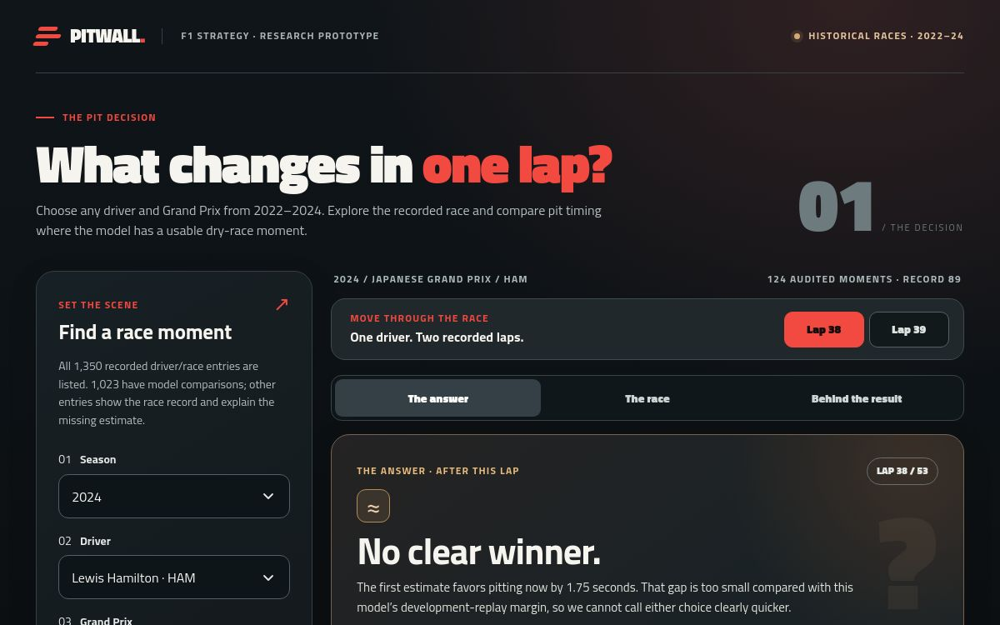

# Pitwall — F1 Race Strategy Optimizer

An interactive research prototype for one question: **at this historical race moment, how does pitting after this lap compare with waiting one more lap?**

[Try the public dashboard](https://pitwall-race-decision.vercel.app/) · [Explore the evidence and limits](docs/INDEX.md) · [Read the project charter](docs/PROJECT_CHARTER.md)



Choose a season, driver and Grand Prix from 2022–2024. The site shows the recorded race and, where a usable dry decision exists, compares two simulated paths over the **same remaining race distance**. Both paths use the tyre fitted at the historical stop. You can inspect the two complete estimated times, the first time difference and the evidence behind the result. No session ID or manually typed decision key is required.

## What is available

| Public dashboard | Verified scope |
| --- | --- |
| Race picker | 1,350 recorded driver/race entries from 68 Grands Prix in 2022–2024 |
| Pit timing comparison | 1,023 entries have at least one usable comparison; 327 show the race record and explain why an estimate is unavailable |
| Audited research slice | 124 Phase 8 decisions (62 adjacent-lap pairs) with a conservative sensitivity review; **all 124 conclude no clear advantage** after its margin |
| Additional exploration | 1,916 point estimates exported with the frozen development model, clearly labelled exploratory; these have **not** received the full Phase 8 sensitivity audit |

These counts come from the checked-in [catalog and decision exports](website/dist/) and the [catalog test](website/tools/test_catalog.mjs). “Audited” means checked against the project's declared development evidence and assumptions. It does **not** mean the alternative pit decision was observed or proven faster in a real race.

The selected lap-time model recorded **0.392725 s mean absolute error** on comparable development-validation rows, versus **0.410049 s** for the frozen baseline. This measures *single-lap time prediction*, not the accuracy of pit-call recommendations; see the [Phase 6 report](docs/PHASE_6_COMPLETION.md). The protected 2025 evaluation has not been used for a public performance claim.

## How the pieces fit

| Path | What runs | What a visitor sees |
| --- | --- | --- |
| [`website/`](website/) | Static HTML, CSS, JavaScript and precomputed JSON, deployed to Vercel | The public race picker and saved comparisons. It calls **no live analysis API** and does not train a model in the browser. |
| [`backend/`](backend/) | FastAPI, data preparation, frozen-model integration, simulation and tests | Research and local development services. The public Vercel site does not host this backend. |
| [`frontend/`](frontend/) | Separate React/Vite client for the FastAPI contract | A local development interface with deterministic requests and in-memory paired-analysis jobs when the verified artifacts are present. It is **not** the deployed public site. |

The static exports were generated from verified 2022–2024 development inputs. The Python exporters are in [`website/tools/`](website/tools/). Raw/processed data, model binaries and Phase 6–9 report artifacts are intentionally absent from Git; exporting again or running real API analyses requires the separately held, integrity-checked development bundle. See [website setup and provenance](website/README.md) and the [API contract](docs/API_DASHBOARD_CONTRACT.md).

## Try it locally

A fresh clone can run the public site without private research artifacts:

```bash
python -m http.server 8000 --directory website/dist
```

Open [http://localhost:8000](http://localhost:8000). To check every recorded picker entry and its available comparison state, run:

```bash
node website/tools/test_catalog.mjs
```

For code checks, use Node.js/npm for the React client and Python **3.14** with [uv](https://docs.astral.sh/uv/) for the backend:

```bash
cd frontend
npm ci
npm test
npm run build

cd ../backend
uv sync --locked
uv run ruff check app tests
uv run pytest -q -W error
```

The backend test suite skips PostgreSQL integration tests without the isolated test database. The API's verified decision catalog and full analysis require the local development data and model/report bundle. After placing that bundle in the repository layout, [`scripts/run_dashboard_local.sh`](scripts/run_dashboard_local.sh) starts the API and React development client. A fresh Git clone alone cannot reproduce the published model or generate new decisions; the static site and checked-in unit tests remain usable.

## Interpretation and limits

- The quick estimate is one deterministic calculation. The reviewed Phase 8 band and any paired-scenario interval answer different questions; neither is a real-world correctness probability.
- Every shown stop uses a declared **20-second pit-loss assumption**, not a measured circuit-specific pit loss. The next tyre is the historically fitted dry compound, not a free choice.
- Selected decision snapshots are dry and green flag. This prototype does not model future rain, Safety Cars, detailed traffic interactions, rival responses, live telemetry or automatic tyre selection.
- Historical data reveal only the action actually taken. The other route is simulated. There is no validated claim of optimal real-world pit strategy or protected-2025 strategy performance.

This is an independent educational project, unaffiliated with Formula 1, the FIA or any team. The site uses an original mark and [Titillium Web under the SIL Open Font License](website/dist/fonts/OFL.txt); it does not include official logos or broadcast footage.

For methods, reports, setup boundaries and the archived phase history, start with the [documentation guide](docs/INDEX.md).
